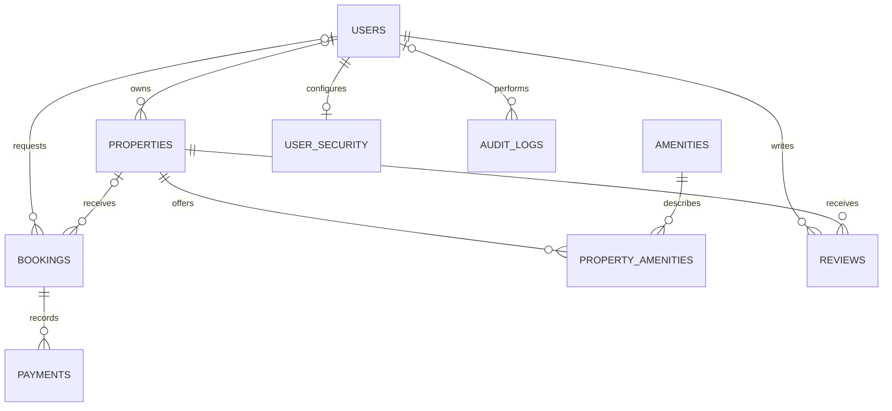

# SettleIn database design

MySQL/MariaDB relational storage. The exact active DDL is in [schema.sql](../server/database/schema.sql). This dictionary is generated by `npm run docs:database` from structure only; no records or credentials are included.

## Relationships and cardinalities

A landlord owns zero or many properties; imported properties may have no assigned owner. A new booking requires exactly one authenticated user and one published property. Legacy bookings with missing parents retain null references and their original row in migration_archive. A booking may have zero or many historical payment rows; the payment service records at most one successful current payment under a row lock. A property and an amenity have a many-to-many relationship resolved by property_amenities. Each user can save at most one review per property. One user may configure one security record. Guest/system audit entries may have no user. Contact messages are independent support submissions.

## Normalization and history

Entities have primary keys and declared foreign keys. Amenity values occupy individual rows; property_amenities uses a composite key rather than comma-separated or JSON lists. Retired group-inquiry structures are outside the active application. Unique email, amenity name and resident/property review constraints prevent duplication.

Historical snapshots are deliberate: booking property_title/student_id/booking_fee preserve the reservation's original details when an account, listing or fee changes. Payment receipt attributes live only in payments. API payment_status, paid_at, payment_reference and payment_method are joined projections, not duplicated booking columns. payment_required records the independent fee requirement for legacy and new applications. Historical booking snapshots describe the agreement at the time of reservation and depend on that reservation, rather than representing current user/listing attributes.

The completion migration preserves original orphaned booking rows and legacy multivalued fields in migration_archive before repairing references. It does not fabricate users or properties. Archive tables and retired prototype tables are not editable through the application.

## Attribute dictionary

### users

| Attribute | SQL type | Nullable | Key | Default |
| --- | --- | --- | --- | --- |
| id | int(11) | NO | PRI | NULL |
| name | varchar(100) | NO | — | NULL |
| email | varchar(100) | NO | UNI | NULL |
| student_id | varchar(100) | YES | — | NULL |
| course | varchar(100) | YES | — | NULL |
| campus | varchar(50) | YES | — | strathmore |
| residence_area | varchar(100) | YES | — | NULL |
| phone | varchar(50) | YES | — | NULL |
| role | enum('student','landlord','admin') | YES | — | student |
| created_at | timestamp | NO | — | current_timestamp() |
| password_hash | varchar(255) | YES | — | NULL |
| university_affiliation | varchar(255) | YES | — | NULL |
| campus_branch | varchar(255) | YES | — | NULL |
| year_of_study | tinyint(3) unsigned | YES | — | NULL |
| is_verified_student | tinyint(1) | NO | — | 0 |
| avatar_url | varchar(2048) | YES | — | NULL |

### properties

| Attribute | SQL type | Nullable | Key | Default |
| --- | --- | --- | --- | --- |
| id | varchar(50) | NO | PRI | NULL |
| title | varchar(255) | NO | — | NULL |
| type | varchar(50) | NO | — | NULL |
| price | int(11) | NO | — | NULL |
| location | varchar(100) | NO | — | NULL |
| campus | varchar(50) | NO | — | NULL |
| distance | varchar(100) | YES | — | NULL |
| verified | tinyint(1) | YES | — | 1 |
| image | varchar(500) | YES | — | NULL |
| description | text | YES | — | NULL |
| landlord | varchar(100) | YES | — | NULL |
| phone | varchar(50) | YES | — | NULL |
| whatsapp | varchar(50) | YES | — | NULL |
| vacant_units | int(11) | YES | — | 1 |
| created_at | timestamp | NO | — | current_timestamp() |
| wifi_rating | decimal(2,1) | YES | — | NULL |
| wifi_speed_mbps | int(11) | YES | — | NULL |
| has_dedicated_desk | tinyint(1) | YES | — | NULL |
| has_backup_generator | tinyint(1) | YES | — | NULL |
| quiet_hours_start | varchar(5) | YES | — | NULL |
| quiet_hours_end | varchar(5) | YES | — | NULL |
| quiet_hours_policy_enforced | tinyint(1) | YES | — | NULL |
| max_study_guests | int(11) | YES | — | NULL |
| last_inspected_at | timestamp | YES | — | NULL |
| booking_fee | int(11) | YES | — | NULL |
| owner_id | int(11) | YES | MUL | NULL |
| review_status | varchar(30) | YES | — | NULL |
| gender_policy | varchar(100) | YES | — | NULL |
| furnishing_status | varchar(100) | YES | — | NULL |

### bookings

| Attribute | SQL type | Nullable | Key | Default |
| --- | --- | --- | --- | --- |
| id | int(11) | NO | PRI | NULL |
| user_id | int(11) | YES | MUL | NULL |
| property_id | varchar(50) | YES | MUL | NULL |
| property_title | varchar(255) | YES | — |  |
| status | varchar(50) | YES | — | active |
| move_in_date | varchar(100) | YES | — | NULL |
| expected_arrival_time | varchar(50) | YES | — | NULL |
| lease_start_date | varchar(50) | YES | — | NULL |
| lease_end_date | varchar(50) | YES | — | NULL |
| relocation_window_start | varchar(100) | YES | — | NULL |
| relocation_window_end | varchar(100) | YES | — | NULL |
| lease_duration | varchar(50) | YES | — | 1 Semester (4 months) |
| notes | text | YES | — | NULL |
| created_at | timestamp | NO | — | current_timestamp() |
| student_id | varchar(100) | YES | — |  |
| booking_fee | decimal(12,2) | YES | — | NULL |
| payment_deadline | varchar(30) | YES | — | NULL |
| payment_required | tinyint(1) | NO | — | 1 |

### payments

| Attribute | SQL type | Nullable | Key | Default |
| --- | --- | --- | --- | --- |
| id | int(11) | NO | PRI | NULL |
| booking_id | int(11) | NO | MUL | NULL |
| amount | decimal(12,2) | NO | — | NULL |
| status | varchar(30) | YES | — | pending |
| reference | varchar(100) | YES | — | NULL |
| created_at | timestamp | NO | — | current_timestamp() |
| method | varchar(20) | YES | — | NULL |
| paid_at | varchar(30) | YES | — | NULL |

### amenities

| Attribute | SQL type | Nullable | Key | Default |
| --- | --- | --- | --- | --- |
| id | int(11) | NO | PRI | NULL |
| name | varchar(100) | NO | UNI | NULL |

### property_amenities

| Attribute | SQL type | Nullable | Key | Default |
| --- | --- | --- | --- | --- |
| property_id | varchar(50) | NO | PRI | NULL |
| amenity_id | int(11) | NO | PRI | NULL |

### reviews

| Attribute | SQL type | Nullable | Key | Default |
| --- | --- | --- | --- | --- |
| id | int(11) | NO | PRI | NULL |
| user_id | int(11) | NO | MUL | NULL |
| property_id | varchar(50) | NO | MUL | NULL |
| stars | tinyint(4) | NO | — | NULL |
| comment | text | NO | — | NULL |
| created_at | timestamp | NO | — | current_timestamp() |

### contact_messages

| Attribute | SQL type | Nullable | Key | Default |
| --- | --- | --- | --- | --- |
| id | int(11) | NO | PRI | NULL |
| name | varchar(100) | NO | — | NULL |
| email | varchar(100) | NO | — | NULL |
| subject | varchar(100) | NO | — | NULL |
| message | text | NO | — | NULL |
| status | varchar(20) | NO | — | open |
| created_at | timestamp | NO | — | current_timestamp() |

### user_security

| Attribute | SQL type | Nullable | Key | Default |
| --- | --- | --- | --- | --- |
| user_id | int(11) | NO | PRI | NULL |
| secret | varchar(255) | NO | — | NULL |
| enabled | tinyint(1) | NO | — | 0 |
| last_counter | bigint(20) | NO | — | -1 |

### audit_logs

| Attribute | SQL type | Nullable | Key | Default |
| --- | --- | --- | --- | --- |
| id | int(11) | NO | PRI | NULL |
| actor_id | int(11) | YES | MUL | NULL |
| action | varchar(100) | NO | — | NULL |
| target_id | varchar(100) | NO | — | NULL |
| created_at | timestamp | NO | — | current_timestamp() |

### migration_archive

| Attribute | SQL type | Nullable | Key | Default |
| --- | --- | --- | --- | --- |
| source_table | varchar(64) | NO | PRI | NULL |
| source_id | varchar(100) | NO | PRI | NULL |
| snapshot | longtext | NO | — | NULL |
| reason | varchar(255) | NO | — | NULL |
| archived_at | timestamp | NO | — | current_timestamp() |

## Business constraints

Publication and review status change together. New reservations start pending/unpaid with a 24-hour payment deadline. Payments and reservation decisions lock the booking row and commit their audit records in the same transaction. Approval decrements available capacity only when a verified vacancy exists. Cancelling an approved reservation restores capacity. Listings with reservation history cannot be deleted. Prepared SQL parameters carry user input; dynamic column names are allowlisted.

## Access and operations

Students access their own reservations/profiles, landlords submit/read owned listings, and administrators manage approvals, reports, users and logs. Passwords use salted scrypt. Authenticator secrets use AES-256-GCM and an external key. Server sessions contain hashed random tokens in memory for one hour. Hosted connections require verified TLS. The deployment guide covers backups, separate migration credentials and hosted configuration.
